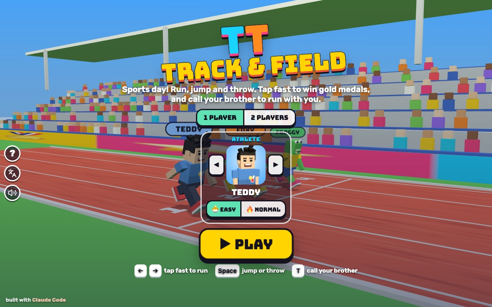

# TT Track & Field

Press **?** any time (or tap the round **?** button on the left edge) to see the keys. The game waits while you look.
Tap the language button under it (the A文 icon) to switch between English and 中文; the dashboard and every game remember the choice.

**中文：** 田径运动会：快快点小脚丫跑步，跳远、扔标枪、跨栏，拿金牌，还可以叫兄弟陪你跑。

A sports day starring Teddy and Tommy: the 100 m sprint, the long jump, the javelin and the 60 m hurdles. Tap left, right, left, right as fast as you can to run, then jump at the board, throw at the line or hop the hurdles. Medals go on a podium, the winner does his signature move under the confetti, and the whole sports day ends with a medal table. 1 player races Foxy 🦊 and Froggy 🐸; 2 players race each other. It's built with Claude Code from plain JavaScript and Three.js, in the same style as Metro Surfer and the other Teddy & Tommy games. There are no image, model or audio files: the stadium, the crowd, the hurdles and the javelins are boxes, cylinders and canvas-painted textures, the characters come from the shared kit (`kit/`), and every sound is synthesised.

The name lives in one place, [js/title.js](js/title.js). "TT Track & Field" is a working title until Alan names it.

## Play

- **Double-click `index.html`.** It works offline, because Three.js and the kit are copied into `kit/`. Without internet the logo falls back from the Bungee font to Arial Black.
- **Send one file:** `dist/track-field-tt.html` is the whole game in one file. AirDrop or email it, then open it in a browser.
- **Rebuild that file** after any edit: `python3 kit/tools/bundle.py . --name track-field-tt`
- **Get kit updates** from `~/claude-games/kit`: `python3 ../kit/tools/sync.py .`, then rebuild.
- **Saved per browser:** 1 or 2 players, who's playing, each athlete's EASY / NORMAL, the best mark in each event on each level (with who set it), and how many sports days each athlete has won. `index.html` and `dist/track-field-tt.html` each keep their own, because they're different ways of opening the game.

### How hard

| | 🐣 EASY (for Tommy, the default) | 🔥 NORMAL (for Teddy) |
|---|---|---|
| running | every tap counts, either foot | left, right, left, right: the same foot twice is a weak step |
| long jump, javelin | press near the line for a big jump or throw; forget, and you jump or throw at the line by yourself (smaller). No fouls. | press near the line and **hold**: a dial over your head rises, let go at the gold (40–50°). Over the line is a **FOUL**. |
| hurdles | long floaty hops, and any hop over a hurdle clears it; a knock costs a little | shorter hops, the hurdle has to be in the middle of the hop; a knock costs a lot |
| Foxy and Froggy | slower | faster |

Each player picks his own level, so in 2 players Tommy can run EASY while Teddy runs NORMAL. The JUMP / THROW button glows when it's the right moment.

## The events

| | | |
|---|---|---|
| 🏃 100 M SPRINT | tap fast to the finish line | lowest time wins |
| 🦘 LONG JUMP | run up the runway, jump at the white board, land in the sand | 3 tries, the longest counts, measured from the board |
| 🎯 JAVELIN | run up, throw before the white line; it flies on a real arc | 3 tries, the longest counts, measured from the line |
| 🚧 60 M HURDLES | 5 hurdles in every lane: tap to run, JUMP to hop | lowest time wins; knocking a hurdle over slows you down |
| 🏅 SPORTS DAY | all four in a row | gold 3 points, silver 2, bronze 1; most points wins the cup (then most golds, then silvers) |

Everyone runs at the same time in their own lane, field events too. Every race starts with ON YOUR MARKS, SET, GO! (no false starts: taps before GO just don't count). If a little runner stops tapping, he walks home after 25 seconds, so a race never gets stuck. After each event the top three stand on the podium with their medals, and the card shows everyone's marks and tries.

## Controls

| Touch | 1 player | 2 players | |
|---|---|---|---|
| the two 🦶 buttons | `←` `→` (or `A` `D`) | `A` `D` · `←` `→` | run: tap left, right, left, right |
| JUMP / THROW | `Space` (or `↑` `W`) | `W` · `↑` | jump or throw; NORMAL: hold, let go at the gold |
| his face (right) | `T` | `T` (or 🙌) | call your brother; 2 players: a high five |
| ❚❚ button | `P` / `Esc` | same | pause |
| 🔊 button | `M` | same | sound on/off (the same switch as every game) |
| ◀ ▶, EASY / NORMAL | `←` `→`, `E` | `A` `D`, `←` `→` | pick the athlete, how hard (title) |
| ▶ PLAY, then an event card | `Enter`, then `1`–`5` | same | start |

The pads are on screen all the time; with a keyboard they show their keys. In 1 player the feet are bottom left and JUMP / THROW bottom right; in 2 players each player has his own feet and button on his own side (on a phone held upright, the button sits above the feet). Everything stays clear of the kit's round buttons on the left edge.

## Companion

Call your brother any time, as often as you like: press `T` or tap his face. (Teddy's brother is Tommy; when Tommy plays, Teddy comes.)

1. He pops in at his buddy size, says hi with his signature move (Tommy's Y with peace fingers, Teddy's boxing) and tosses a treat (🍦 💧 🧃 🍪 🍉 🍌), with a toast like "🍦 ICE CREAM FROM TOMMY!".
2. Then he does this game's helper, **he paces you on the next event**: "TOMMY SAYS: I'LL PACE YOU! RUN WITH ME!". Called during an event, he joins it straight away; called on the podium or the menus, he paces the next one.
3. While pacing he runs just behind your lane, a step ahead of you (he waits if you slow down). Chasing him makes every tap count 30 % more, he never lets you drop below a jog, the JUMP window is bigger, NORMAL's dial rises slower, a knocked hurdle costs less, and he shouts "JUMP!" before each hurdle and "JUMP NOW!" / "THROW NOW!" at the line.
4. When that event ends he says bye with his goodbye move (Tommy's Y, Teddy's jump shot with a 🏀) and pops out.

In 2 players, `T` (or the 🙌 button) is a high five between the brothers.

## How it was checked

All of it was tested muted (`localStorage['claudeGames.muted'] = '1'`), with sound checked in code, never by ear.

- **`node tools/check.js`** (about 0.4 s) runs the headless rules check in [js/checks.js](js/checks.js), for all four events on both levels:
  - **fps:** the same taps and presses give exactly the same result (`===`, and the same positions every 30 steps) replayed at 24, 30, 50, 60, 90, 120, 144 and 240 fps and with jittery frames, with and without the pacing brother (216 replays). It works because every try runs in fixed 1/120 s steps, each tap is stamped with the time it happened, and flights follow the exact curve.
  - **fair lanes:** the same inputs score the same in lane 1, 2 or 3, as Teddy or as Tommy (Tommy is drawn smaller; the javelin leaves everyone's hand at the same height), and identical inputs share gold.
  - **effort:** tapping faster always scores better, in every event and level.
  - **measuring:** jumps are measured from the board and throws from the line (checked against the exact formula, taking off up to 1.2 m early).
  - **fouls, medals, hurdles, pacing:** NORMAL over the line is a foul with no mark; EASY never fouls; a no-mark gets no place and no medal; ties share a place; the medal table's winner; knocking hurdles costs time, less on EASY; pacing always helps, called before or during a try.
  - **kids can win:** on EASY, 5 taps a second beats Foxy and Froggy in the sprint in 30 of 30 seeds; NORMAL friends are faster than EASY ones; the CPU friends are the same for the same seed.
- **`node tools/check.js --fail`** runs three broken variants (one step per frame, a 5 % faster lane 2, measuring from the take-off). Each one is caught (fps, fair lanes, measuring FAIL), so it prints FAILED and exits 1.
- **In the page, `game.check()`** runs the same rules check plus the real game loop: each event on both levels driven through the game's own frame code at 30, 60 and 144 fps gives `===` results. `game.check({ fail: 'fps' })` fails the loop check too.
- **In the Browser pane:** every event played by a scripted runner (`game.bot(0, { rate: 5 })`), the countdown, flags and pops, the angle dial, the javelin flight, the podium, the 2-player meet to the medal table, the companion (hello, treat, pacing, the shouts, bye), the high five, phone portrait (390x844), phone landscape (740x360) and iPad (1024x768), no console errors. With `Kit.lang.set('zh')` every screen (title, events, ? panel, countdown, each event, pause, every result card, the medal table, 2 players, fouls and hints) gives `Kit.lang.untranslated()` = []. In English no Chinese shows except the kit's own language button label.

## Files

| | |
|---|---|
| [js/title.js](js/title.js) | the name |
| [js/sim.js](js/sim.js) | the rules: tapping, speed, the four events, CPU friends, fouls, marks, places, medals (no drawing; runs in node too) |
| [js/checks.js](js/checks.js) | the headless rules check and its scripted runner |
| [js/scene.js](js/scene.js) | the stadium, crowd, hurdles, pits, javelin field, podium, effects and camera |
| [js/game.js](js/game.js) | menus, the meet, input, HUD, the companion, results, `window.game` |
| [js/friends.js](js/friends.js) | Foxy and Froggy (copied from TT Bowling) |
| [js/sfx.js](js/sfx.js) | the game's own synth sounds |
| [js/keys.js](js/keys.js), [js/zh.js](js/zh.js) | the ? panel's keys, the 中文 dictionary |
| [tools/check.js](tools/check.js) | the check in node |

## Not verified

- Sound by ear (tested muted only).
- Real fingers on an iPad or phone: very fast two-thumb tapping on iOS Safari (multi-touch on the foot buttons was only exercised with synthetic events).
- A real double-click: the `file://` page was only opened in headless Chrome for the screenshot.
- Whether the balance suits the real kids: 🐣 EASY assumes Tommy taps about 5 times a second; Teddy on 🔥 NORMAL needs about 9 to beat Foxy.
- Adding it to an iPad home screen.
